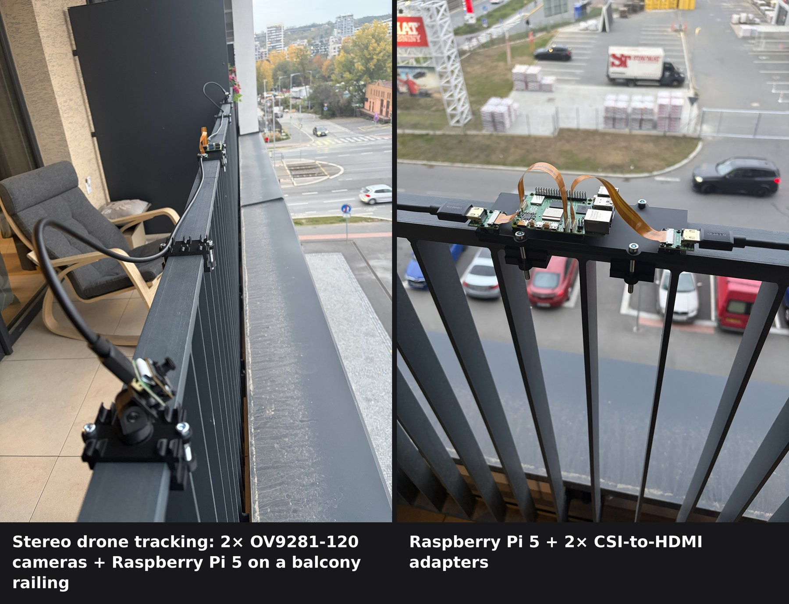
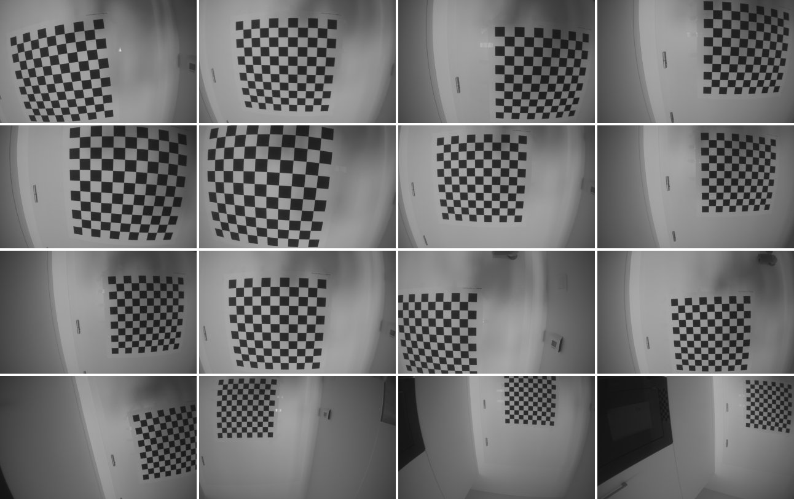
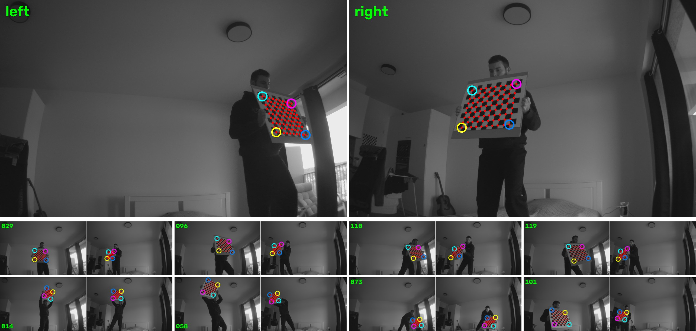
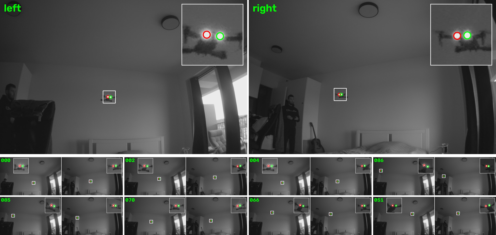
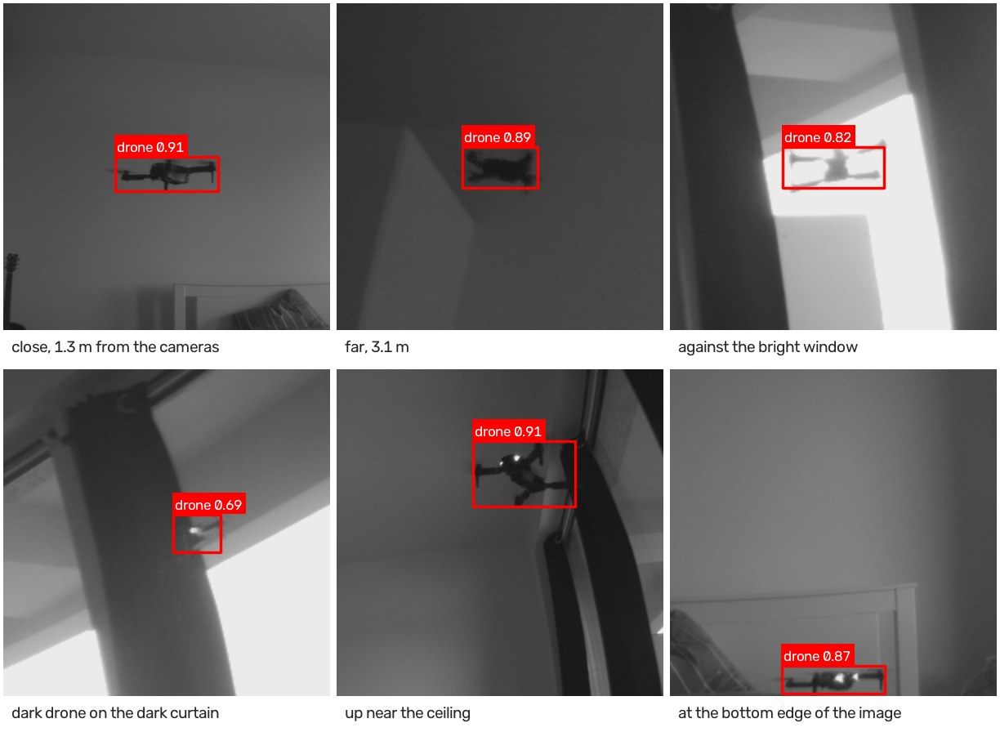

# Real-time 3D Drone Tracking

A stereo camera rig on a Raspberry Pi 5 that detects drones in the sky in real time and tracks them in 3D.
Two global-shutter OV9281-120 cameras sit on a balcony railing and send synchronized frames to the Pi.
YOLO detects the drone in each view, and the calibrated camera pair triangulates its position in 3D.

https://github.com/user-attachments/assets/569ca110-99da-4ee8-86b5-f3a4488d2f9a

*A 60 s indoor flight seen by both cameras (top) and its reconstructed 3D path (bottom). The cameras stand 1 m above the floor; the path is coloured by height, and the thin lines show the two viewing rays that meet at the drone.*

## Hardware setup

Each camera's CSI ribbon goes into a CSI-to-HDMI adapter, so a standard HDMI cable can carry the signal along the railing to the Pi. All mounts are 3D-printed and clamp onto the railing; the models are in [3d-models/](3d-models/).

## Calibrating intrinsics

Each camera is calibrated on its own from 60–70 photos of a printed checkerboard, using OpenCV's rational distortion model to handle the wide-angle lens. The results are in [calibration/](calibration/): camera A reaches 0.17 px RMS reprojection error and camera B 0.26 px.

## Calibrating extrinsics

### 1. Using a checkerboard

A checkerboard on a rigid backing is moved through the area both cameras see, and 58 sharp synchronized pairs with the board fully visible in both views are kept. One row of squares is cut off the board (10×9 inner corners, 40 mm squares) so each corner gets the same number in both views. A square board can be numbered from a different corner in each camera. With each camera's intrinsics held fixed, OpenCV's stereo calibration reaches 0.44 px RMS and puts the cameras 1.96 m apart, matching the tape-measured distance.

### 2. Using the drone's LEDs (if the cameras look far into the sky)

When the cameras look far into the sky, a checkerboard can't be held in front of them, but the drone itself can serve as the target. Its two front LEDs show up as small saturated spots in both synchronized views, and they are matched by their left-to-right order in the image. Triangulated with the checkerboard extrinsics, the two LEDs come out 41–42 mm apart in every pair below, with under 1 px reprojection error, so their points are accurate enough to calibrate from.

## Detecting the drone with YOLO

The detector is trained on frames recorded with the rig in the room over six sessions, and labelled in CVAT. A first model, trained on a small hand-labelled set, pre-labels the remaining frames, so most of them only need their box checked. YOLO11n is fine-tuned at 640 px for 100 epochs on 1,104 images: 982 with the drone and the rest without it. On a separate session of 146 images it reaches 0.999 precision, 0.99 recall and 0.95 mAP50-95. That session shows the same room from the same viewpoint, so these numbers measure this setup, not detection in general. The scripts are in [detection/](detection/).

## Reconstructing the flight in 3D

Every synchronized pair is recorded at 30 fps, with no dropped frames. YOLO finds the drone in both views, and in each box the point used is the centre of the dark drone shape, which the two cameras agree on better than the box centre. A pair is triangulated only when its two points lie within 5 px of each other's epipolar lines. In the 60 s flight above, the median distance is 0.6 px, and 1,581 of the 1,801 pairs pass. A constant-velocity Kalman filter with a backward smoothing pass joins the points into one path and fills the short gaps where one camera misses the drone. The floor is placed 1 m below the cameras, using their 21° upward tilt, and the drone comes out flying at 1.3–2.5 m. The code is in [reconstruction/](reconstruction/).
